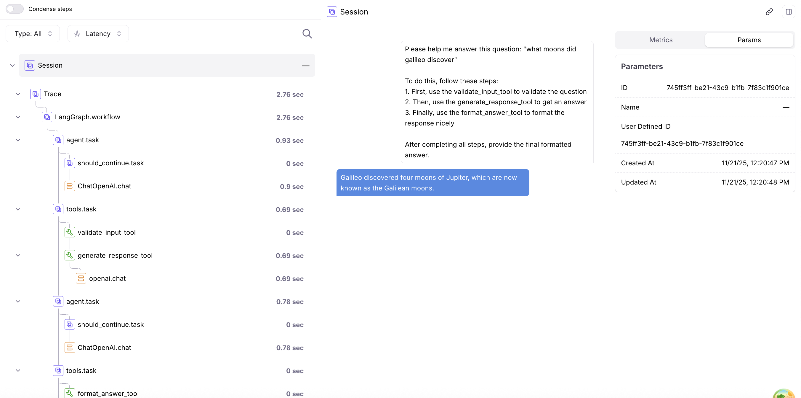

# LangGraph + Traceloop + Splunk AO Integration

## Splunk AO setup (ai-demo-apps)

- **Install:** Does **not** use the `splunk-ao` package (no extra). It sends OTLP to AO with the API key in the exporter headers.
- **Instrumentation:** OpenTelemetry, manual setup in code; exports OTLP straight to AO without the `splunk-ao` package. See [../../../knowledge/instrumentation/otel-manual.md](../../../knowledge/instrumentation/otel-manual.md).
- **Source:** copied from [`splunk/splunk-ao-python`](https://github.com/splunk/splunk-ao-python/tree/59cd6b450b6a78ccbe12de82f660107500bbc956/examples/agent/langgraph-traceloop) `examples/agent/langgraph-traceloop` (Apache-2.0, see [LICENSE](../../../LICENSE) and [NOTICE](../../../NOTICE)). Clone/path instructions in the upstream text below refer to the upstream repo; here the app lives in `apps/agent/langgraph-traceloop`.

Environment variables (pick **one** deployment, never both):

| Deployment | Variables |
| --- | --- |
| On-prem / standalone AO | `SPLUNK_AO_API_KEY` (required), `SPLUNK_AO_CONSOLE_URL` (required), `SPLUNK_AO_API_URL` (optional) |
| Splunk Observability (o11y) Cloud | `SPLUNK_AO_REALM`, `SPLUNK_AO_O11Y_TOKEN` (and optionally `SPLUNK_AO_O11Y_API_TOKEN`) |

Do not mix on-prem and o11y Cloud variables: the SDK picks the deployment from the variables it
finds and rejects an ambiguous mix. On o11y Cloud do not set `SPLUNK_AO_CONSOLE_URL` or
`SPLUNK_AO_API_URL`. Routing: `SPLUNK_AO_PROJECT` and `SPLUNK_AO_AGENT_STREAM`.
Copy `.env.example` (or `env.example`) to `.env` and fill it in locally; `.env` is git-ignored and
must never be committed.

This example demonstrates how to add comprehensive observability to your LangGraph AI workflows using **Traceloop** (OpenLLMetry) and Splunk AO. Traceloop provides a simpler alternative to direct OpenTelemetry instrumentation while still giving you detailed traces showing execution flow, LLM calls, token usage, and input/output data.


## Quick start

### Prerequisites

- Python 3.12+
- [UV package manager](https://docs.astral.sh/uv/getting-started/installation/)
- [Splunk AO account](https://app.galileo.ai) (free)
- OpenAI API key

### Installation

```bash
# Clone and navigate
git clone https://github.com/rungalileo/sdk-examples
cd sdk-examples/python/agent/langgraph-traceloop

# Install dependencies
uv sync

# Create environment file
cp .env.example .env
# Edit .env with your API keys (see below)
```

### Environment variables

Create a `.env` file in the project root with the following variables:

```bash
# Your Splunk AO API key (get from https://app.galileo.ai/settings/api-keys)

TRACELOOP_BASE_URL=https://api.galileo.ai/otel

TRACELOOP_HEADERS="Splunk-AO-API-Key=your_splunk_ao_api_key_here, project=traceloop, logstream=default, X-Use-Otel-New=true"

# Your OpenAI API key
OPENAI_API_KEY=your_openai_api_key_here
```

| Variable             | Required | Description                                                             |
| -------------------- | -------- | ----------------------------------------------------------------------- |
| `TRACELOOP_BASE_URL` | Yes      | The base URL for the Traceloop Client it will send traces to Splunk AO    |
| `TRACELOOP_HEADERS`  | Yes      | The headers for the Traceloop Client to send to Splunk AO                 |
| `OPENAI_API_KEY`     | Yes      | Your OpenAI API key from [OpenAI](https://platform.openai.com/api-keys) |

### Run

```bash
uv run python main.py
```

This runs a question-answering LangGraph workflow with comprehensive Traceloop tracing. Check your Splunk AO project for detailed traces!

## Example Trace in Splunk AO

After running the agent, you'll see a detailed trace in the Splunk AO UI showing the complete execution flow:


