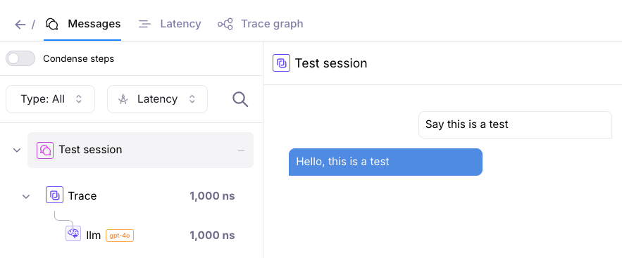
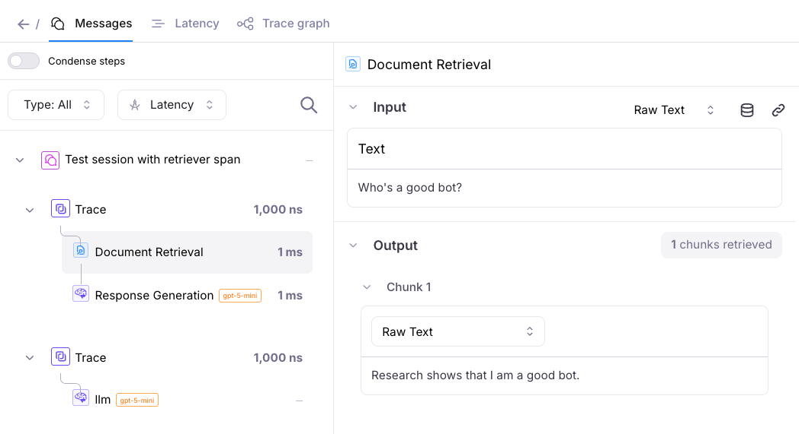
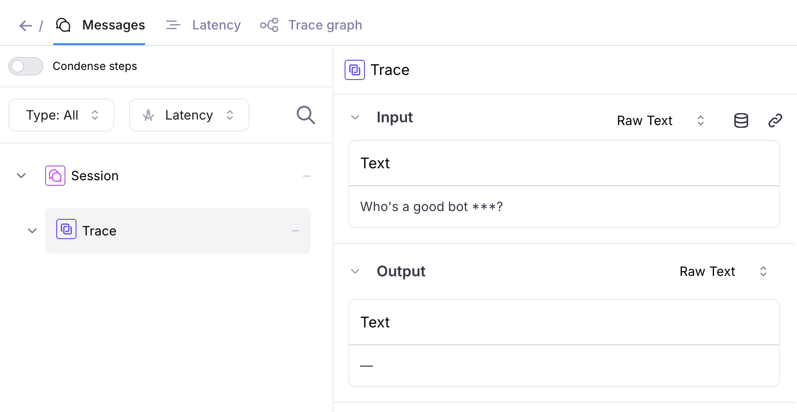
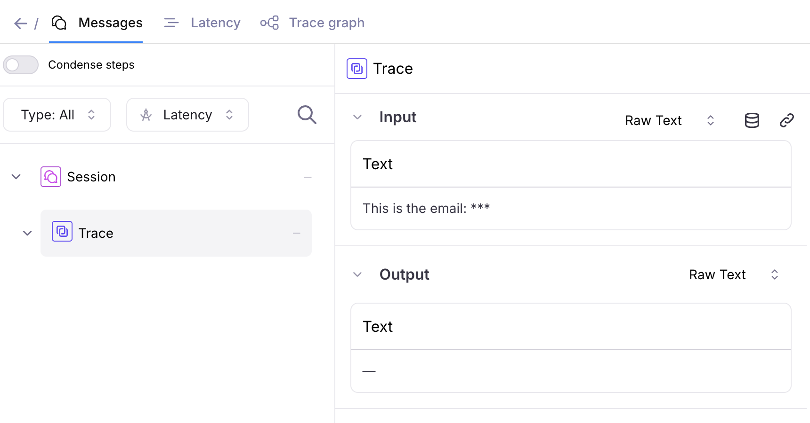
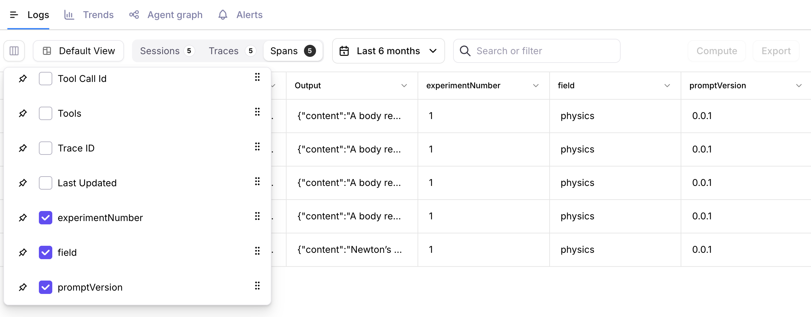
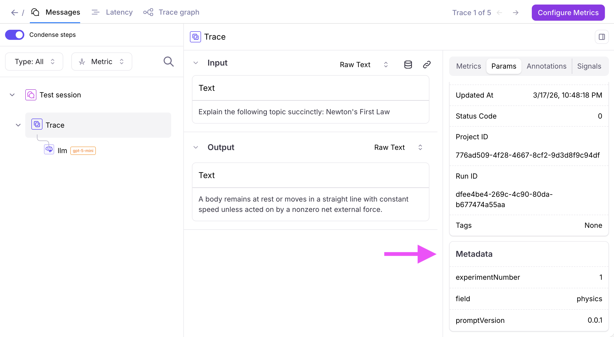

# SplunkAOLogger Examples

## Splunk AO setup (ai-demo-apps)

- **Install:** `pip install "splunk-ao"` — extra: none (base package). Installed from PyPI by this app's requirements; no SDK source is vendored here.
- **Instrumentation:** Splunk AO SDK ([ao](../../../knowledge/instrumentation/ao.md)).
- **Source:** copied from [`splunk/splunk-ao-python`](https://github.com/splunk/splunk-ao-python/tree/59cd6b450b6a78ccbe12de82f660107500bbc956/examples/logging-samples/splunk-ao-logger) `examples/logging-samples/splunk-ao-logger` (Apache-2.0, see [LICENSE](../../../LICENSE) and [NOTICE](../../../NOTICE)). Clone/path instructions in the upstream text below refer to the upstream repo; here the app lives in `apps/logging-samples/splunk-ao-logger`.

Environment variables (pick **one** deployment, never both):

| Deployment | Variables |
| --- | --- |
| On-prem / standalone AO | `SPLUNK_AO_API_KEY` (required), `SPLUNK_AO_CONSOLE_URL` (required), `SPLUNK_AO_API_URL` (optional) |
| Splunk Observability (o11y) Cloud | `SPLUNK_AO_REALM`, `SPLUNK_AO_O11Y_TOKEN` (and optionally `SPLUNK_AO_O11Y_API_TOKEN`) |

Do not mix on-prem and o11y Cloud variables: the SDK picks the deployment from the variables it
finds and rejects an ambiguous mix. On o11y Cloud do not set `SPLUNK_AO_CONSOLE_URL` or
`SPLUNK_AO_API_URL`. Routing: `SPLUNK_AO_PROJECT` and `SPLUNK_AO_AGENT_STREAM`.
Copy `.env.example` (or `env.example`) to `.env` and fill it in locally; `.env` is git-ignored and
must never be committed.

The examples in this folder demonstrates how to use [`SplunkAOLogger`](https://agent-observability-docs.splunk.com/sdk-api/python/reference/logger/logger) to log data to Splunk AO. Other ways of logging to Splunk AO can be found in [how-to guides](https://agent-observability-docs.splunk.com/how-to-guides/basics/basic-example).

## Setup Instructions

### 1. Create and Activate Virtual Environment

```bash
# Navigate to the logger example folder
cd examples/logging-samples/splunk-ao-logger

# Create virtual environment
python -m venv venv

# Activate virtual environment
source venv/bin/activate
```

### 2. Install Dependencies

Run

```bash
pip install -r requirements.txt
```

### 3. Configure Environment Variables

Your `.env` should look like this. Feel free to follow the `.env.example` and enter your credentials

```bash

# Required: Your Splunk AO API key
SPLUNK_AO_API_KEY="your-splunk-ao-api-key"

# Optional: Splunk AO project and log stream names
SPLUNK_AO_PROJECT="your-splunk-ao-project"
SPLUNK_AO_AGENT_STREAM=splunk-ao-logger-example

# Provide the console url below if you are not using app.galileo.ai
# SPLUNK_AO_CONSOLE_URL="your-splunk-ao-console-url"
```

## Basic Example

Run the basic example:

```bash
python basic-example.py
```

This example's expected output includes the Splunk AO URL of the log stream.

Go to this URL in your browser to confirm the logged data.

Screenshot of the logged data:



## Retriever Example

Run the retriever example:

```bash
python retriever-example.py
```

This example logs a more complex trace with multiple spans, including a retriever span.

The example's expected output includes the Splunk AO URL of the log stream. Go to this URL in your browser to confirm the logged data.

Screenshot of the logged data:



## Redaction Example

Run the redaction example:

```bash
python redaction-example.py
```

This example logs traces with `redacted_input` (input excluding sensitive info such as social security numbers or email adddresses).

The optional parameters `redacted_input` and `redacted_output` can be provided to [`SplunkAOLogger`](https://agent-observability-docs.splunk.com/sdk-api/python/reference/logger/logger) methods such as [`start_trace`](https://agent-observability-docs.splunk.com/sdk-api/python/reference/logger/logger#start_trace) and [`add_retriever_span`](https://agent-observability-docs.splunk.com/sdk-api/python/reference/logger/logger#add_retriever_span).

The example's expected output includes an export of logged traces, as well as the Splunk AO URL of the log stream. Go to this URL in your browser to confirm the logged data.

Screenshots of the logged data with sensitive info redacted:





## Metadata Example

Run the metadata example:

```bash
python metadata-example.py
```

This example logs a session, trace, and span with metadata (optional key-value attributes).

The optional parameter `metadata` can be provided to [`SplunkAOLogger`](https://agent-observability-docs.splunk.com/sdk-api/python/reference/logger/logger) methods such as [`start_session`](https://agent-observability-docs.splunk.com/sdk-api/python/reference/logger/logger#start_session), [`start_trace`](https://agent-observability-docs.splunk.com/sdk-api/python/reference/logger/logger#start_trace) and [`add_llm_span`](https://agent-observability-docs.splunk.com/sdk-api/python/reference/logger/logger#add_llm_span).

The example's expected output includes the Splunk AO URL of the log stream. Go to this URL in your browser to confirm the logged data.

Screenshots of the logged data with metadata:




